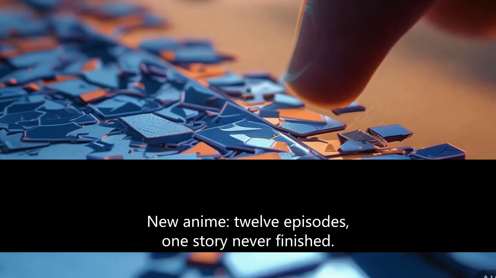

# 译制流水线（DUB）：从一条中文视频到英文配音版

> 面向「AI 视频译制 / 多模态」岗位的第二个产物：和生成流水线共用工具层，
> 但链路完全不同——生成是"无中生有"，译制是"改写已有"。



---

## 1. 这条流水线到底在做什么

给它一条**已经带中文字幕和中文配音**的视频，它输出：

- 一条**英文字幕**（时间轴与配音对齐）
- 一条**英文配音**的音轨
- 原中文字幕被盖掉（否则双语叠在一起，不能看）
- 画面不动（不改内容，只换语言）

```
video.mp4
  │ ① extract_audio      ffmpeg 抽 16k 单声道
  ▼
audio.wav ──② transcribe（whisper）──► 13 句中文 + 时间戳
                                        │ ③ translate（LLM，整段一次）
                                        ▼
                                     13 句英文
                                        │ ④ synthesize（edge-tts，英文音色）
                                        ▼
                                     13 段 mp3（实测时长）
                                        │ ⑤ align（atempo 压进时长预算 + 排布落点）
                                        ▼
                                     dubbed.m4a + subs.en.srt
                                        │ ⑥ mux（盖原字幕 + 换音轨 + 烧英文字幕）
                                        ▼
                                     final.mp4 ──⑦ QC
```

代码位置：

| 步骤 | 文件 | 关键点 |
|---|---|---|
| ① 抽音轨 | `app/dub/media.py` | whisper 只吃 16k 单声道 |
| ② 识别 | `app/dub/asr.py` | 本地 faster-whisper，走 HF 镜像 |
| ③ 翻译 | `app/dub/translate.py` | 整段一次 + 条数校验 + 长度预算重试 |
| ④ 配音 | `app/dub/tts.py` | 复用生成流水线的 TTS（含静音剪除） |
| ⑤ 对齐 | `app/dub/media.py` | `atempo` + `adelay`，最容易被低估的一步 |
| ⑥ 合流 | `app/dub/pipeline.py` + `tools/render.py` | 覆盖带 + 烧字幕 + 换音轨 |
| ⑦ 质检 | `app/dub/qc.py` | 5 个可量化指标 |

---

## 2. 每一步为什么这么设计（初学者向）

### ② 为什么用本地 whisper，不用云 ASR

- **零成本**：53 秒音频在 CPU 上跑 `small` 约 2 分钟，不花钱。
- **可复现**：不依赖账号和额度，面试官 clone 下来就能跑。
- **代价**：小模型会错字。实测把"00 后"听成"零零"、"水日常"听成"水日长"。
  所以翻译 prompt 里专门写了一条：**"原文来自语音识别，可能有同音错别字，请先按上下文纠正"**——
  这一步把 ASR 的错挡在了翻译层，比换更大的模型便宜得多。

### ③ 为什么整段翻译，而不是一句一句翻

1. 中文常省略主语（"那为什么补？"），单句翻译会指代不清；
2. 一次调用能看到上下文，术语和人称才统一；
3. 便宜：1 次调用 vs 13 次。

代价是模型可能少给几条。实测遇到过一次"输入 13 条、返回 11 条"，
所以代码里**强制校验 id 与条数**，对不上就带着具体错误重试一次。

### ③½ 为什么要在 prompt 里写"字数预算"

这是整条链路最容易被忽略、但对成片影响最大的一件事：

> 同一句话，**英文比中文长 30%–50%**。如果放任翻译自由发挥，
> 每句配音都会超过原来的时间槽，最后要么声音重叠，要么越拖越晚。

所以 prompt 里给了硬预算：`每条译文长度 ≤ sec × 14`（14 字符/秒 ≈ 英文口播速度）。
但**约束只写在 prompt 里是不够的**——模型经常超。代码里还会检查一遍，
超了就带着"id=3 超长（限 42 字符，实际 58）"这样的具体意见重试。

### ⑤ 时间轴对齐：整条链路的技术核心

三个动作，缺一不可：

```
1) 压：clip 比 slot 长 → atempo 加速，最多 1.6 倍
2) 放：把每段放到原句开始的位置（adelay），不是简单拼接
3) 记账：加速后仍超出的部分记成 overflow，累积漂移记成 tail_drift
```

**为什么不能 concat**：原视频句子之间本来就有停顿，concat 会把停顿吃掉，时间轴立刻错位。
用"静音底轨 + 每段 adelay + amix"才能保住"原位"。

实测：13 句、最大加速 **1.32x**、尾部漂移 **0.0s**、时长 53.63s → 53.63s。

### ⑥ 字幕擦除：为什么最后选了"遮挡"而不是"修复"

原片的中文字幕是**烧进画面**的（hardcoded），不是外挂轨。三条路：

| 方案 | 效果 | 成本 | 结论 |
|---|---|---|---|
| 遮挡重绘（本实现） | 稳定，但盖住底部画面 | 低 | ✅ 当前方案 |
| `cv2.inpaint` 修复 | 1000×120 区域补出来是糊的 | 中 | ❌ 观感更差 |
| 生成式修复（ProPainter 等） | 最好 | 要 GPU，数小时 | 后续 |

**踩过的三个坑**（都写进了代码注释）：

1. 用 Canny 边缘密度找字幕 → 锁到了画面里的高对比物体，字幕只盖住一半；
2. 改成"白色像素行分布" → 仍然会被画面里的白色碎片带跑；
3. 最终：**取亮度密度最高的 16% 滑动窗口**，并且**允许 CLI 手动指定**
   `--cover-y / --cover-h`——自动检测在复杂画面上不可能 100% 准，留一个手动口子是工程常识。

### ⑥½ libass 的坐标系陷阱

`subtitles` 滤镜给 SRT 用的是 **384×288 的虚拟坐标系**，`MarginV` 会被放大 `H/288` 倍。
直接按像素写 `MarginV=190`，字幕会被顶到画面中间——我们就是这么把字幕烧到画面正中过一次。

正确写法：

```python
margin = (height - band_bottom + 12) * 288 / height   # 像素 → libass 单位
```

### ⑦ 质检：只测能测的

| 指标 | 阈值 | 为什么 |
|---|---|---|
| `duration_match` | 与原片差 ≤1.5s | 说明没吞片段、没拖长 |
| `segment_count` | 句子 = 配音 = 字幕条数 | 少了就是丢句 |
| `speed_reasonable` | 最大加速 ≤1.45x | 超过 1.5 倍人耳能听出"快进感" |
| `no_major_overflow` | 单句溢出 ≤1.0s | 溢出会压到下一句 |
| `coverage` | 配音总长 ≥ 原片 35% | 防止"大部分没配" |

**测不了的**：口型是否匹配、翻译是否地道、配音情绪是否合适——这些要么上模型，要么人评。

---

## 3. 实测结果

```
源视频：53.63s / 13 句 / 中文
成片：  53.63s / 英文字幕 13 条 / 最大加速 1.32x / 漂移 0.0s
质检：  通过（5/5）
耗时：  ASR 128s + 翻译 3s + TTS 26s + 混音 3s + mux 59s ≈ 3.7 分钟
```

逐句样例：

| 原文（ASR） | 译文 |
|---|---|
| 2024年,B站老番二创播放量翻了三倍,主角是零零 | In 2024, classic anime fan edits tripled on Bilibili, led by Gen Z |
| 那为什么补? | So why go back? |
| 新番一季十二集,讲不完一个故事 | New anime: 12 episodes a season, can't tell one story |

---

## 4. 怎么跑

```powershell
# 默认：中 → 英
.\.venv\Scripts\python.exe scripts\dub.py --video "dev_out/videos/01_xxx.mp4"

# 指定音色 / 模型 / 术语表 / 手动字幕带
.\.venv\Scripts\python.exe scripts\dub.py --video in.mp4 `
    --voice en-US-GuyNeural --model medium `
    --glossary glossary.json --cover-y 620 --cover-h 360
```

产物在 `artifacts_dub/<时间戳>_<视频名>/`：
`final.mp4`、`subs.en.srt`、`dubbed.m4a`、`asr.json`、`translation.json`、`clips.json`、`report.md`。

---

## 5. 已知限制（面试时主动说）

| 限制 | 原因 | 下一步 |
|---|---|---|
| 底部画面被黑带盖住 | 遮挡重绘的必然代价 | 接 ProPainter 一类视频修复，只对字幕区域做 inpainting |
| 没有口型同步 | wav2lip 在 CPU 上数秒/帧，30s 视频要几十分钟 | 评估商业 API 或只对固定机位近景做 |
| 一次只翻一种语言 | 当前一条链路一个 target | 同一份 ASR 结果并行跑多语言，产物加语言后缀 |
| 没有接进任务队列 | 先验证链路，再工程化 | 给 `tasks` 加 `pipeline` 字段，复用现有队列/租约/幂等 |
| ASR 专有名词会错 | `small` 模型 + 中文同音字 | 术语表回灌 ASR `initial_prompt`，或换 `medium` |
