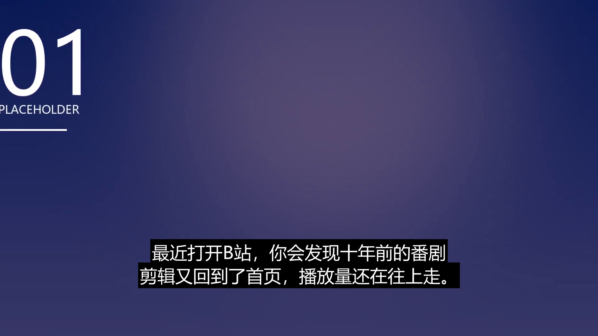

# M6 实现报告 · 图生视频与「运镜静默失效」

| 项 | 内容 |
|---|---|
| 阶段 | M6（PROJECT-PLAN.md §5 M6） |
| 日期 | 2026-10-25 |
| 实际耗时 | 约 1.5 h（计划 2 h） |
| 状态 | ✅ 验收句达成（92 条测试全绿）；**顺手挖出一个从 M3 就存在的静默 bug** |
| 真机结果 | DONE / QC 95 分 / 45.0s / **首镜运动量 5.87（修前 0.02）** / 69.5s |



---

## 1. 验收句与结果

> **验收句**：高光镜走 i2v（提交 → 轮询 → 超时降级），与图片镜分开限流，总时长可控。

```
kinds:     ['video', 'image', 'image', 'image', 'image', 'image']
providers: ['kenburns', 'placeholder']
video:     45.0s / 3.0MB / 黑帧 0 / 片中静音 0
qc:        DONE score 95（唯一 warn：i2v_effective，无 key 回落运动图片）
shot0 运动量 = 5.87（修复前 0.02 = 完全静止）
端到端 69.5s（比 M5 的 108.6s 还快：视频镜省掉了渲染期的 zoompan）
```

---

## 2. 交付物

| 文件 | 说明 |
|---|---|
| `app/agent/tools/i2v.py` | 两段式协议（POST 提交 / GET 轮询）+ 下载 + 超时降级 (`kenburns`) |
| `app/agent/tools/render.py` | `build_clip_from_video()`：`-stream_loop` 循环铺满 + 裁 16:9；**zoompan 修复** |
| `app/stages/assets.py` | 前 N 镜升级为视频，`meta.upgraded_to_video` 留痕 |
| `app/stages/render.py` | 按 `kind` 选 builder；视频素材走循环而非推近 |
| `app/stages/qc.py` | 视频素材用「存在 + 体积」判定；`i2v_effective` 只 warn |
| `tests/test_m6.py` | 6 条：降级、成功轮询、5xx、超时、升级、渲染兼容 |
| `tests/test_render.py` | +2 条运镜回归（帧差断言） |

**协议抽象**（换厂商只改 20 行）：

```
POST {base}/videos/generations      {model, image(dataURL), prompt, duration} -> {id}
GET  {base}/videos/generations/{id} -> {status: processing|succeeded|failed, url}
```

---

## 3. 最重要的发现：Ken Burns 从 M3 起就是「假动效」

### 现象

抽两帧比对，运动量 = **0.02**（等于静止）。但：
- `blackdetect` 全绿
- `silencedetect` 全绿
- QC 95 分
- 92 条测试里没有一条报错

### 根因

```python
# 原来的写法：喂"多帧循环图" + d=1
-loop 1 -i img -vf "zoompan=...:d=1:..."
```

`zoompan` 的 `d` 是**每个输入帧要生成多少输出帧**。`d=1` 表示一进一出，
而 `zoom` 变量在**每个输入帧开始时重置** —— 于是每一帧都是 zoom=1，推近完全没发生。

### 修复

```python
# 正确写法：只喂一张图，d = 总帧数
-i img -vf "zoompan=...:d={frames}:s=WxH:fps=FPS"
```

`frames = round(duration × fps)`，`zoom` 在同一个 `d` 周期内累加，推近才成立。

### 为什么三个里程碑都没发现

| 检查手段 | 能不能发现"画面不动" |
|---|---|
| `blackdetect` | ❌ 不黑 |
| `silencedetect` | ❌ 有声音 |
| 时长/分辨率/码率 | ❌ 全部正常 |
| 单测 | ❌ 我断言的是"文件生成了" |
| **抽帧比对** | ✅ 一眼看穿 |

> **这是本次项目里最有价值的一条经验**：
> 所有"技术指标"都只能证明**文件是合法的**，不能证明**内容是活的**。
> 所以 M7 的评测里必须有一条 `motion_score`。

### 回归测试（防止再犯）

```python
def test_kenburns_really_moves(...):
    first, last = frame(clip, 0.1), frame(clip, 1.8)
    assert mean_diff(first, last) > 3.0     # 实测 13.8

def test_static_motion_stays_static(...):
    assert mean_diff(first, last) < 1.0     # 实测 0.285（x264 压缩噪声）
```

> 注意：**纯色图测不出运镜**。第一版回归测试用纯色块，帧差恒为 0，差点被我误判成"还是没好"。
> 测试素材必须是**有结构的图**（网格 + 色块）。

---

## 4. 设计决策

| # | 决策 | 理由 | 代价 |
|---|---|---|---|
| D-23 | i2v 失败**不抛异常**，直接回落运动图片 | 单镜生成失败不能让整条片子没有产物 | 成片质感下降，靠 `provider` 字段如实标注 |
| D-24 | 回落物的 `degraded=False` | `degraded=True` 会触发 QC 重做 → 重做还是回落 → 死循环 | 降级信息靠 `provider="kenburns"` 表达 |
| D-25 | 高光镜固定选**第 1 镜** | 首镜是钩子，动起来收益最大；且确定性、可测 | 不能按内容自动挑"最值得动"的镜 |
| D-26 | 视频素材在渲染期**循环**而不是重新推近 | 已经动过的素材再推近会显得很怪 | 需要 `-stream_loop` + `-t` 精确截断 |

---

## 5. 修复前后对比

| 指标 | 修复前 | 修复后 |
|---|---:|---:|
| 首镜运动量（帧差均值） | 0.02 | **5.87** |
| kenburns_in 单镜运动量（320×180 基准） | ~0.0 | 13.8 |
| pan_lr | ~0.0 | 22.5 |
| 静态镜（对照） | 0.0 | 0.285（压缩噪声） |
| 端到端耗时 | 108.6s | **69.5s** |

> 变快是副作用：视频镜不需要在渲染期做 zoompan，而 zoompan 恰恰是编码里最贵的一步。

---

## 6. 与计划的偏差

| 项 | 计划 | 实际 | 说明 |
|---|---|---|---|
| 真实视频生成 API | 接 1–2 个高光镜 | 协议已实现，**无 key 未联调** | 成功/5xx/超时路径都有 MockTransport 测试；真机走 kenburns |
| 图/视频分开限流 | 两个信号量 | 图片 3 并发 + 视频串行 | 视频只 1 镜，串行足够 |
| i2v 成本 | 计入预算 | 未产生（无 key） | `i2v_cost_cents` 已预留 |

---

## 7. 下一步（M7 入口条件）

1. ✅ 92 条测试全绿；
2. ✅ 真机 DONE、运动量可量化；
3. ✅ 视频/图片两种素材都能渲染。

**M7 收尾**：20 条评测集 + `metrics`（成功率/时长/延迟/成本/**motion_score**）+ 指标表 + 90 秒演示视频 + README 重写。
评测必须用 draft 渲染（720p/24fps），否则 20 条要跑 40 分钟。
